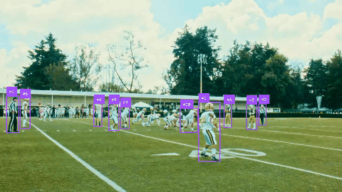

# Football Player Tracker: speed & distance from video

Detects every player in a football clip, follows each one across frames with a stable ID, and measures **distance covered** and **speed (mph)** per player. Outputs an annotated video plus CSVs.

 <!-- add a 5-10 s GIF of your best clip here -->

## How it works

```
video frame ─► YOLOv8 (person detection) ─► ByteTrack (same ID across frames)
            ─► feet point (bottom-center of box) ─► homography: pixels → field yards
            ─► smoothing + outlier removal ─► speed / distance per player
```

| Step | Why |
|---|---|
| **YOLOv8n** detects people | Pretrained on COCO, fast enough for CPU |
| **ByteTrack** links detections into tracks | Also keeps low-confidence boxes, so players survive brief occlusion |
| **Feet point**, not box center | The feet touch the field plane, so the pixel→field mapping is valid there |
| **Homography** from 4+ known field points | Corrects perspective: a yard far from the camera is fewer pixels than a yard close to it |
| **Smoothing + 25 mph cap** | Box jitter and ID switches create fake "teleport" speeds |

## Results

| Clip | Players tracked | Top speed (mph) | Max distance (yd) | Notes |
|---|---|---|---|---|
| _your clip_ | | | | |

_Sanity check:_ on a synthetic clip where everyone moves at a known 3.68 mph, the tracker measured 3.5–3.6 mph average and 5.2 of 5.3 yards, with all 4 IDs stable for all 90 frames.

## Run it

```bash
pip install -r requirements.txt

# 1) Quick run (speeds in pixels/sec)
python track.py --video clips/play.mp4

# 2) Real units: click 4+ field points with known yard positions
python calibrate.py --video clips/play.mp4 --frame 0
python track.py --video clips/play.mp4 --field-points field_points.json
```

Outputs go to `outputs/<clip name>/`: `annotated.mp4`, `tracks.csv` (per frame), `summary.csv` (per player), `run_info.json`.

## Limitations (and what I'd do next)

- **Moving camera:** a single homography only holds while the camera is still. Broadcast footage pans and zooms. Next: re-estimate the homography per frame from yard-line detection.
- **ID switches** when players pile up. Next: add appearance features (BoT-SORT / ReID) and measure ID switches with MOTA/IDF1 on a labeled clip.
- **Everyone is a "person":** refs and sideline staff get tracked too. Next: classify teams by jersey color (k-means on torso pixels) and drop non-players.
- **CPU speed:** YOLOv8n runs at roughly 5–15 fps on a laptop CPU. A GPU or a smaller input size makes it real-time.

## Stack
Python · Ultralytics YOLOv8 · ByteTrack · Supervision · OpenCV · NumPy · Pandas
